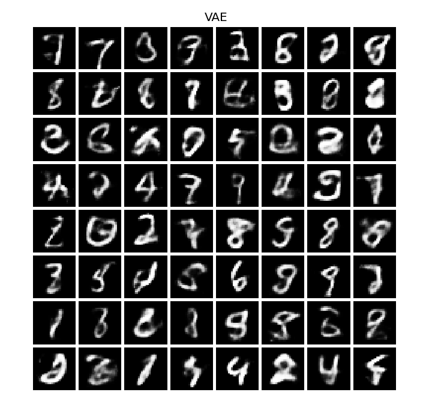
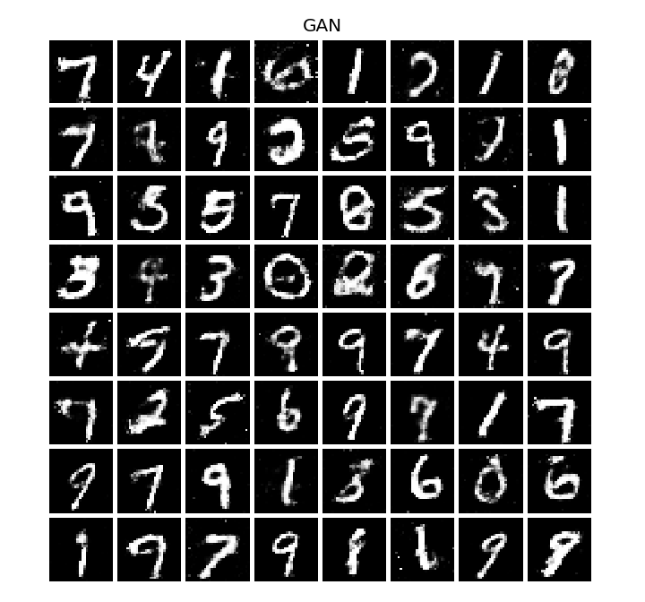

# GAN vs VAE on MNIST

An independent academic project comparing two small generative models for handwritten digits. Both use a 20-dimensional latent space. A CNN trained on real MNIST images supplies classifier diagnostics and 128-dimensional features for a custom Fréchet distance.

The comparison includes generated samples, latent interpolation, training curves and predicted digit distributions. The experiment records its settings, data checksums and source hashes, and saves the trained models for inference.

## Recorded full run

Seed 42, 60,000 training images, 50 epochs per generative model and 5,000 generated images per model. The frozen digit classifier reached 99.05% accuracy on the 10,000 real test images. That accuracy evaluates the classifier, not either generative model.

| Image set | CNN Fréchet distance | Mean classifier confidence | Predicted-class entropy (nats) |
| --- | ---: | ---: | ---: |
| VAE | 224.3125 | 79.89% | 2.2605 |
| GAN | 56.9913 | 92.05% | 2.2304 |
| Real vs real control | 1.5449 | 99.00% | 2.3013 |
| Uniform random pixels | 1123.5248 | 72.82% | 0.8625 |

All rows use the same CNN and sample count. Lower distance means closer Gaussian CNN feature statistics in this run. Confidence and entropy describe classifier predictions and need visual inspection for context.

| VAE samples | GAN samples |
| --- | --- |
|  |  |

The grids show the first 64 generated images from the shared evaluation noise, without manual sample selection. See the [training curves](results/benchmark/training.png), [latent interpolation](results/benchmark/interpolation.png) and [full run manifest](results/benchmark/metrics.json). These are single-seed results, not a general ranking of GANs and VAEs.

## Run in GitHub Codespaces

[Open in Codespaces](https://codespaces.new/Parisa6Izadyar/generative-AI)

The container installs Python 3.12 and CPU dependencies. After setup finishes, open **Terminal → New Terminal** and run:

```bash
python -m pytest -q
python -m gan_vae train --preset quick --download
```

The first MNIST download needs an internet connection. The dataset is cached under `data/MNIST/`; subsequent runs can omit `--download`. No API key, Drive mount or manual upload is required.

The quick preset uses 10,000 training images, 3 classifier epochs and 5 epochs for each generative model. It evaluates 1,000 generated images per model. It checks the complete workflow with a smaller budget; its scores should be read separately from the full benchmark.

To repeat a run in the same output directory, add `--overwrite`, or choose a new directory with `--output`.

## Local setup

The tested environment is Linux, Python 3.12 and CPU PyTorch. From the repository root:

```bash
python -m venv .venv
source .venv/bin/activate
python -m pip install torch==2.9.1 torchvision==0.24.1 --index-url https://download.pytorch.org/whl/cpu
python -m pip install -r requirements.txt
python -m pytest -q
```

The explicit CPU install avoids downloading CUDA libraries for a CPU machine. For a CUDA environment, install the matching versions using the [official PyTorch instructions](https://pytorch.org/get-started/previous-versions/), then pass `--device cuda`. The recorded benchmark uses CPU; identical results across devices or library versions are not guaranteed.

## Full experiment

```bash
python -m gan_vae train --preset full --download --output results/full
```

This trains the classifier for 5 epochs and each generative model for 50 epochs on all 60,000 official training images. It evaluates 5,000 generated images per model against 5,000 randomly selected official test images. A disjoint set of 5,000 real test images and uniform random pixels provide comparison controls. The classifier's accuracy uses all 10,000 official test images.

Training uses fixed budgets and the final checkpoint. There is no hyperparameter search, early stopping or checkpoint selection based on the test data. The two models share the same generated latent vectors during evaluation. Equal epoch counts and latent dimensions do not make their parameter counts or computation costs equal.

The recorded run is in [`results/benchmark/`](results/benchmark/). See [validation](docs/validation.md) for the execution record and [methodology](docs/methodology.md) for the protocol and metric definitions.

Training saves progress at the end of each epoch. If a session stops, use the same settings and output directory to continue:

```bash
python -m gan_vae train --preset full --output results/full --resume
```

Resume restores completed epochs, model and optimizer states, random-number state and shuffle order. It requires the same configuration, data and source files. An unfinished epoch is repeated from its last saved boundary. `--overwrite` starts fresh instead.

The full experiment can also run on GitHub: open **Actions → Full MNIST benchmark → Run workflow**. Its downloadable artifact contains metrics, figures, trained models and epoch checkpoints for 30 days. The workflow also reloads the saved models and verifies every recorded diagnostic. The ordinary test workflow uses synthetic tensors and does not download MNIST.

## Saved outputs and inference

Each completed run writes:

- `metrics.json`: configuration, dataset and source hashes, versions, training history and evaluation results.
- `models.pt`: VAE, generator and frozen classifier weights with their configuration.
- `progress/`: epoch checkpoints for continuing interrupted training.
- `vae_samples.png`, `gan_samples.png`, `interpolation.png`, `training.png` and `predicted_classes.png`: visual diagnostics.

Generated outputs and dataset downloads stay out of version control. Only the explicitly recorded benchmark and historical project artifacts are tracked.

Generate new samples from a saved run without downloading data or training again:

```bash
python -m gan_vae generate --checkpoint results/full/models.pt --output results/generated --seed 123
```

## Offline execution check

```bash
python -m gan_vae smoke
```

This exercises training, evaluation, checkpoint saving and plotting on small random tensors. It produces no evidence about MNIST generation quality. CI runs the automated tests and executes every notebook cell in this mode, without a dataset download.

## Notebook

Open [`notebooks/ParisaIzadiyar_GI_Prj.ipynb`](notebooks/ParisaIzadiyar_GI_Prj.ipynb) with the Python environment above and run all cells. Download MNIST once using the CLI first. The notebook imports the same implementation as the CLI and defaults to the quick preset. Its first training cell explains how to choose the full preset or permit a download.

## Interpreting the results

The custom **CNN Fréchet distance** compares Gaussian summaries of this classifier's features. Lower values indicate closer feature statistics within the same evaluator and protocol. It is not standard Inception FID, and a distance near zero does not prove that two image distributions are identical.

Mean classifier confidence describes how strongly the CNN assigns a digit label. It is not calibrated image quality. Predicted-class entropy describes the balance of those labels, not diversity within a digit class. Read these diagnostics alongside the image grids and the real-image and random-noise controls.

This is a single-seed comparison of small MLP models. It does not establish a general GAN-versus-VAE ranking, rule out memorization or demonstrate performance on other datasets.

## Project structure

| Path | Contents |
| --- | --- |
| `gan_vae/` | Networks, data handling, training, evaluation and CLI |
| `notebooks/` | Walkthrough using the shared implementation |
| `tests/` | Data isolation, metric edge cases, training and reload checks |
| `results/benchmark/` | Recorded full MNIST run and generated samples |
| `docs/` | Methodology, validation and review notes |
| `docs/legacy_figures/` | Figures from the original experiment |
| `docs/legacy_presentation/` | Original February 2026 presentation with historical terminology |

The [review notes](docs/changes.md) explain the corrections to the original evaluation. The historical presentation remains available as an academic record; its “FID” label refers to the custom CNN distance, and its broad claims about guaranteed stability and diversity are not supported by this experiment.

MNIST downloads use [Torchvision's MNIST loader](https://docs.pytorch.org/vision/0.24/generated/torchvision.datasets.MNIST.html). Dataset files and trained checkpoints are not bundled in the repository.
